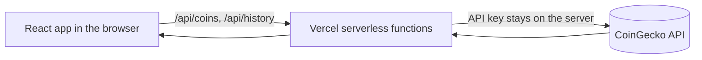

<div align="center">

# DCA Crypto: Monthly Crypto Investment (DCA) Calculator

**See what a regular weekly or monthly crypto investment would be worth today.**


[**Live Demo**](ADD-YOUR-VERCEL-LINK-HERE) · [Report a Bug](../../issues)

</div>

## Overview

Dollar Cost Averaging (DCA, also called SIP) means investing the same amount on a fixed schedule instead of one big payment. This app answers: **"If I had invested a fixed amount every week or month, what would I have today?"**

The user picks a coin, an amount, how often to buy and a past period. The app shows the total money invested, the coins collected, their value today and the profit or loss.

## Features

- **Weekly or monthly** purchase plans over a chosen date range
- **Top 50 coins** in a searchable dropdown with real coin icons and live prices
- **5 currencies** (INR, USD, EUR, GBP, AED) with country flags
- **Summary cards** for total invested, coins collected, value today and profit or loss (amount and percent)
- **Area chart** comparing the money invested with the value of the coins over time
- **Purchase table** with the price, coins bought, value today and gain or loss of every purchase
- **Input checks** for the amount, the dates and the 12-month history limit, with clear error messages
- **Responsive** layout and **accessible** controls (labels, keyboard support, reduced-motion support)

## Tech Stack

| Area | Technology |
|---|---|
| Frontend | React 18 (Vite) |
| Styling | Tailwind CSS v4 |
| Charts | Recharts |
| Icons | Lucide React |
| Backend | Node.js (Vercel serverless functions) |
| Data | CoinGecko API |
| Testing | Vitest |
| Hosting | Vercel |

## How It Works



1. The app builds the list of buy dates: every 7 days, or the same day each month. For short months it uses the last day of the month.
2. It asks `/api/history` for daily prices. One request covers the whole period.
3. For each buy date it picks the closest price and calculates the result in `src/utils/calc.js`:

| Step | Formula |
|---|---|
| Coins bought | `amount / price on that day` |
| Total invested | `amount x number of purchases` |
| Value today | `total coins x latest price` |
| Profit or loss | `value today - total invested` |

## Project Structure

```
.
├── api/
│   ├── coins.js          # Top 50 coins with icons and live prices
│   └── history.js        # Daily price history of one coin
├── public/
│   └── favicon.svg
├── src/
│   ├── components/
│   │   ├── Dropdown.jsx  # Searchable dropdown (coins and currencies)
│   │   ├── HeroArt.jsx   # Hero illustration
│   │   └── motion.jsx    # Scroll reveal and count-up animations
│   ├── utils/
│   │   ├── calc.js       # Buy dates and DCA calculation
│   │   └── calc.test.js  # Unit tests
│   ├── App.jsx           # Main page
│   ├── data.js           # Currency list and built-in coin list
│   ├── useCoins.js       # Loads the live coin list
│   ├── index.css         # Colors, font and animations
│   └── main.jsx          # App entry point
├── .env.example
├── index.html
├── package.json
└── vite.config.js
```

## Getting Started

### Prerequisites

- Node.js 18 or newer
- A free CoinGecko Demo API key from [coingecko.com/en/api](https://www.coingecko.com/en/api)

### Installation

```bash
git clone https://github.com/ketanjethva25/DCA-Crypto.git
cd DCA-Crypto
npm install
```

### Environment variables

Copy `.env.example` to `.env` and add your key:

```bash
# Windows
copy .env.example .env
# macOS / Linux
cp .env.example .env
```

| Name | Required | Description |
|---|---|---|
| `COINGECKO_API_KEY` | Yes | CoinGecko Demo API key. It is used only on the server and never sent to the browser. |

### Run

```bash
npm run dev      # start the app at http://localhost:5173
npm test         # run unit tests
npm run build    # create a production build
```

## API Reference

Both endpoints are Vercel serverless functions. Errors return `{ "error": "message" }`.

| Endpoint | Query parameters | Success response |
|---|---|---|
| `GET /api/history` | `coin`, `currency`, `from` (date, `YYYY-MM-DD`, within the last 12 months) | `{ "prices": [[timestamp, price], ...] }` (daily prices up to today) |
| `GET /api/coins` | `currency` | `[{ "id", "name", "symbol", "image", "current_price" }, ...]` (top 50 coins) |

Responses are cached (5 minutes for history, 60 seconds for coins) to stay within the API limit.

## Deployment

1. Push the code to GitHub.
2. Import the repository in [Vercel](https://vercel.com).
3. Add the environment variable `COINGECKO_API_KEY`.
4. Click **Deploy**. Vercel builds the frontend and runs the `api` folder as serverless functions.

If you add or change an environment variable later, redeploy so it takes effect.

## Design Decisions

- **Serverless functions instead of calling CoinGecko from the browser.** This keeps the API key private and lets the app cache responses.
- **One history request per calculation.** The app does not call the API once per purchase, so it stays fast and within the rate limit.
- **No database.** The app does not need to save anything, so there is nothing to store.
- **Calculation kept separate from the UI.** Buy dates and DCA math are small pure functions with unit tests.
- **Calm design.** One font, a light and green palette, soft shadows and gentle animations. No neon colors or heavy effects.

## Limitations and Future Improvements

- The free CoinGecko plan gives about 12 months of history, so the start date must be within the last year.
- Prices are daily, so each purchase uses the closest daily price.
- Results are estimates. Past results do not predict the future. This is not financial advice.
- Ideas for later: compare with a one-time lump-sum investment, export the purchase table as CSV, longer history with a paid plan.

---

Built by **Ketankumar Jethva** as part of the Scalezix internship assessment. Price data by [CoinGecko](https://www.coingecko.com).
